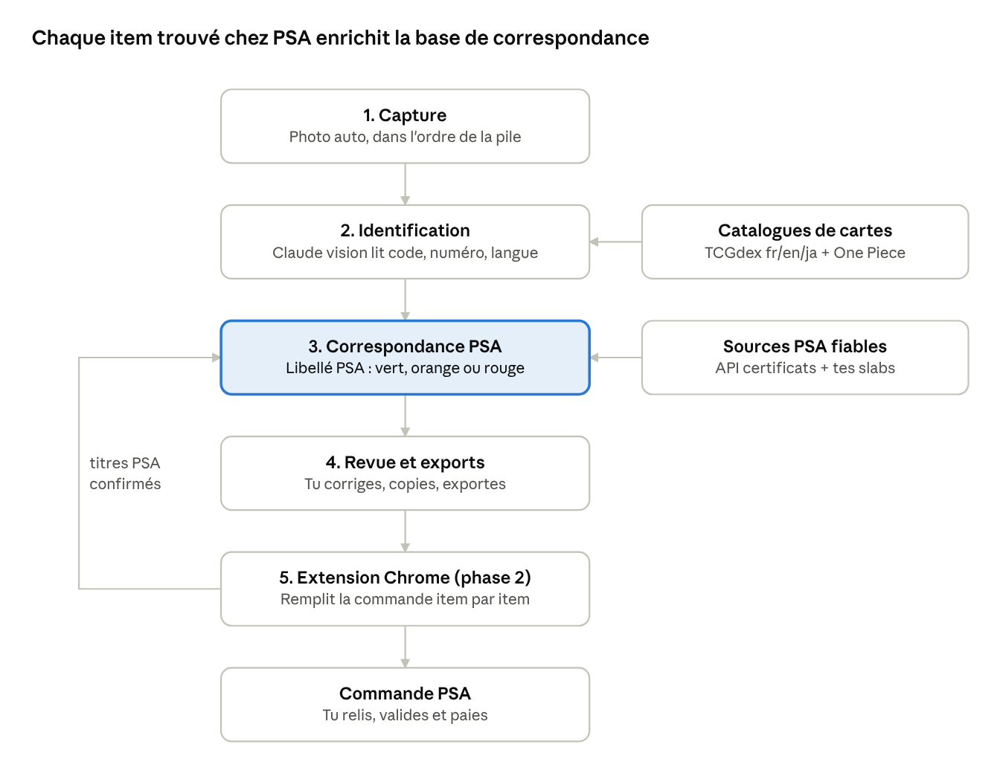

# Cahier des charges — Outil de soumission PSA

Oct 29, 2026 · @Willen

## Mode d'emploi

Ce document est la source de vérité du projet. Exporte-le en Markdown,
enregistre-le sous SPEC.md à la racine d'un dossier vide, puis ouvre ce
dossier dans Claude Code.

**À préparer avant la première session**

- [ ] Claude Code installé (terminal ou appli desktop), Node.js 20+ et
  Google Chrome

- [ ] Un token PSA Public API (compte psacard.com, rubrique Public API)

- [ ] Une clé API Anthropic (console.anthropic.com) pour la lecture des
  cartes en photo

- [ ] Un dossier test-cards/ d'au moins 30 photos réparties sur les 6
  combinaisons (détail dans Jalons)

- [ ] Un fichier certs.txt avec les numéros de certificat de tes slabs
  PSA, un par ligne

**Premier message à envoyer à Claude Code**

Lis SPEC.md en entier. On commence par le jalon M0.  
Avant d'écrire du code : propose la structure du repo, la stack finale
et les questions ouvertes à trancher avec moi.  
Attends mon accord, puis avance jalon par jalon en t'arrêtant à chaque
critère d'acceptation.

Ensuite, un jalon = une session : Claude Code propose, tu valides, il
code, tu testes avec de vraies cartes.

## Contexte et objectif

L'outil transforme une pile de cartes scannées en submission PSA prête :
pour chaque carte, la référence exacte à saisir chez PSA, puis (phase 2)
le formulaire pré-rempli.

**Le problème.** Retrouver le bon item dans la recherche du PSA Online
Submission Center est lent et souvent infructueux. Le scanner de l'app
PSA est optimisé pour les cartes déjà gradées : il échoue sur le
français, le japonais, One Piece et les premières populations.

**Périmètre**

| Jeu                                       | Langues    | Identifiant imprimé                           | Difficulté |
|-------------------------------------------|------------|-----------------------------------------------|------------|
| One Piece                                 | FR, EN, JP | Numéro type OP05-119, identique entre langues | Faible     |
| Pokémon récent (code d'extension imprimé) | FR, EN, JP | Code d'extension + numéro (ex. SV2a 151/165)  | Faible     |
| Pokémon ancien et promos                  | FR, EN, JP | Symbole d'extension, numéro parfois absent    | Élevée     |

**Deux phases**

1.  **Phase 1 — scan → référence** : pour chaque carte, dans l'ordre de
    la pile, la chaîne de recherche PSA ou les champs de saisie
    manuelle.

2.  **Phase 2 — pré-remplissage** : une extension Chrome remplit le
    formulaire PSA dans la session de l'utilisateur, qui valide et paie
    lui-même.

**Hors périmètre** : estimation de note, prix automatiques (valeur
déclarée manuelle en v1), objets autres que des cartes, soumission ou
paiement automatiques, multi-utilisateur.

## Contraintes et principes

Ces règles priment sur toute autre considération, y compris la vitesse
de développement.

1.  **Pas d'API de soumission PSA.** L'API publique PSA ne couvre que la
    vérification d'un certificat par son numéro. La phase 2 passe donc
    par une extension dans le navigateur de l'utilisateur.

2.  **Rien n'est envoyé ni payé automatiquement.** L'extension remplit ;
    l'utilisateur relit, valide et paie lui-même. L'outil ne stocke
    jamais le mot de passe PSA.

3.  **Pas de scraping massif de psacard.com.** Vérifier les CGU de PSA
    avant toute lecture automatisée de pages. Sources prioritaires :
    l'API officielle et les confirmations de l'utilisateur.

4.  **Aucune convention PSA codée en dur.** Les libellés PSA (année, nom
    de set, termes de variété, langue des noms) sont appris à partir de
    libellés réels, set par set.

5.  **La précision avant le rappel.** Mieux vaut « à vérifier » qu'une
    référence fausse affichée avec assurance. Chaque résultat porte un
    statut et un niveau de confiance.

6.  **Sécurité des cartes.** Capture par caméra uniquement. Jamais de
    scanner à chargeur : les rouleaux peuvent marquer une carte
    candidate au 10.

7.  **Secrets hors du code.** Clés dans .env, jamais commitées ; un
    .env.example documente les variables.

## Architecture et stack

Une seule application locale, en TypeScript de bout en bout, qui
enchaîne capture, identification, correspondance PSA et revue ;
l'extension Chrome s'y branche en phase 2.



La boucle de gauche rend l'outil meilleur à chaque submission : chaque
titre trouvé chez PSA devient une correspondance confirmée.

**Stack recommandée** (Claude Code peut en proposer une autre au M0,
s'il la justifie)

- **Langage** : TypeScript partout (app, API, extension), pour partager
  les types.

- **App + API** : Next.js (App Router), qui sert l'interface de scan et
  de revue et les routes API. Tourne en local sur l'ordinateur.

- **Base** : SQLite + Drizzle ORM, un seul fichier facile à sauvegarder.

- **Images** : sur disque dans data/images/, nommées par hash.

- **Lecture des cartes** : API Anthropic (vision), modèle configurable
  dans .env, sortie JSON validée par schéma (zod).

- **Correspondance d'image (secours)** : hash perceptuel via sharp ;
  embeddings plus tard si nécessaire.

- **Extension** : Chrome Manifest V3 en TypeScript.

- **Tests** : Vitest.

**Accès caméra** : un navigateur mobile n'autorise la caméra qu'en HTTPS
(sauf localhost). Deux options à trancher au M0 : webcam de l'ordinateur
en local, ou téléphone via certificat local (mkcert) ou tunnel.

**Structure du repo**

```
psa-prep/
├── SPEC.md
├── CLAUDE.md # décisions et conventions, tenu à jour par Claude Code
├── .env.example
├── app/ # Next.js : scan, revue, API
│ ├── scan/ # capture caméra
│ ├── review/ # revue d'une session
│ └── api/ # identify, resolve, sessions, export, mappings
├── core/ # logique pure, testée
│ ├── identify/ # lecture vision + résolution catalogue
│ ├── psa/ # correspondance PSA, chaînes de recherche
│ └── catalog/ # synchronisation TCGdex et One Piece
├── extension/ # Chrome MV3 (phase 2)
├── data/ # SQLite, images, caches (non commité)
└── test-cards/ # photos de test + truth.csv (non commité)
```

## Phase 1 — Capture

L'utilisateur fait défiler ses cartes sous la caméra ; chaque carte est
capturée automatiquement, dans l'ordre de la pile.

**Installation physique recommandée** : téléphone ou webcam fixé à la
verticale au-dessus d'un fond mat sombre, lumière diffuse sur les côtés
pour limiter les reflets. Cartes nues ou en penny sleeve.

**Comportement attendu**

- Flux de la caméra arrière en résolution maximale, cadre-guide affiché
  à l'écran.

- Détection de la carte dans le cadre (contour rectangulaire, ou simple
  stabilité de l'image en v1).

- Capture automatique quand l'image reste stable pendant un délai
  configurable (défaut 600 ms) : photo pleine résolution, bip et
  vibration.

- Réarmement seulement après un changement net de l'image (carte retirée
  ou remplacée), pour ne jamais capturer deux fois la même carte.

- Capture manuelle par bouton ou touche Espace ; bouton « annuler la
  dernière ».

- Mode recto/verso optionnel : deux captures par carte, utiles comme
  preuve d'état avant envoi.

- Chaque capture enregistre : image, horodatage, position dans la pile,
  identifiant de session.

- L'identification part en arrière-plan dès la capture ; l'écran affiche
  le compteur et le dernier résultat.

**En cas d'échec réseau** : la capture continue, l'identification est
relancée plus tard depuis la file d'attente.

## Phase 1 — Identification

Chaque photo produit une identité de carte vérifiée contre un catalogue
: la lecture seule ne suffit jamais.

**Pipeline**

1.  Recadrage et redressement de la carte (perspective), puis version
    réduite pour l'envoi.

2.  Lecture par Claude vision, en JSON strict validé par schéma : jeu,
    langue, nom imprimé, numéro imprimé, code d'extension, marque de
    rareté, marque de règlement, tampons (1st edition, promo,
    prerelease…), indices de variante (holo, reverse, full art,
    parallèle), confiance par champ. Consigne au modèle : null plutôt
    que deviner.

3.  Résolution dans le catalogue local :

    - **Pokémon** : TCGdex (fr, en, ja), recherche par code
      d'extension + numéro, puis par nom + numéro.

    - **One Piece** : identifiant de carte universel ; catalogue à
      constituer au M0 à partir de sources officielles ou de jeux de
      données ouverts, licence vérifiée.

4.  Secours (cartes anciennes, promos, lecture incomplète) : comparaison
    par hash perceptuel avec les images du catalogue, filtrée par nom et
    langue lus ; 5 candidats maximum.

5.  Variantes que le catalogue ne distingue pas (reverse, tampons,
    parallèles One Piece) : champ variant explicite, tranché par
    l'utilisateur à la revue si besoin.

**Sortie** : CardIdentity = jeu, langue, id d'extension, nom
d'extension, numéro, nom, variante, confiance (0–1), candidats
alternatifs.

**Cache** : une image déjà lue (même hash) n'est jamais renvoyée à
l'API.

**Trous de catalogue** : TCGdex n'a pas le même niveau de complétion
selon les langues. Si une carte FR ou JP manque, se rabattre sur la même
carte en anglais quand elle existe, en conservant la langue réelle de la
carte.

## Phase 1 — Correspondance PSA

C'est le cœur du produit : une base qui traduit chaque carte du
catalogue en libellé PSA exact, alimentée par des sources fiables et
enrichie à chaque submission.

**Sources, par ordre de fiabilité**

1.  **API PSA officielle par numéro de certificat** : chaque slab
    possédé (certs.txt) donne le libellé exact d'une carte. Réponses
    mises en cache définitivement, limites de débit respectées.

2.  **Confirmations de l'utilisateur** : quand un item est trouvé chez
    PSA (à la main ou via l'extension), son titre exact devient une
    correspondance confirmée.

3.  **Pages publiques de population PSA** : seulement si les CGU le
    permettent, derrière un interrupteur désactivé par défaut, à faible
    cadence et avec cache.

**Règles de nommage par set PSA.** Pour chaque set PSA connu, l'outil
dérive des libellés observés : chaîne exacte du set (année, marque,
nom), format du numéro, langue des noms, vocabulaire de variété. Ces
règles servent à déduire le libellé d'une carte jamais gradée.

**Trois statuts de sortie**

| Statut              | Condition                                                | Ce que l'outil affiche                                                                                                            |
|---------------------|----------------------------------------------------------|-----------------------------------------------------------------------------------------------------------------------------------|
| Vert — confirmé     | Correspondance confirmée (API certificat ou utilisateur) | Titre PSA exact à coller, spec si connu                                                                                           |
| Orange — déduit     | Set PSA connu, carte jamais vue                          | Libellé déduit des règles du set, 2 à 3 variantes de recherche, champs de saisie manuelle                                         |
| Rouge — set inconnu | Aucun set PSA correspondant                              | Champs de saisie manuelle au mieux + recommandation de PSA Research Request avant envoi, description et liens sources pré-rédigés |

**Chaînes de recherche.** La recherche PSA est sensible à l'ordre des
mots : l'outil propose plusieurs variantes classées, puis retient celle
qui a fonctionné pour ce set.

**Premières populations.** La saisie manuelle d'un item absent de la
base est possible chez PSA. Le vrai risque est un set entièrement absent
: d'où le statut rouge et la demande de recherche faite en amont.

## Phase 1 — Revue et exports

L'écran de revue est là où l'utilisateur garde le contrôle : rien ne
part vers PSA sans y être passé.

**Liste de session** (une session = une submission), dans l'ordre de la
pile, item 1 = carte du dessus :

- Miniature, identité de la carte, pastille de statut (vert, orange,
  rouge), confiance.

- Chaîne de recherche PSA avec bouton copier ; champs de saisie manuelle
  (année, set, numéro, nom, variété), chacun copiable.

- Valeur déclarée (saisie manuelle en v1) et notes libres.

- Choix parmi les candidats ; correction de n'importe quel champ.

- Bouton « Trouvé chez PSA » + champ pour coller le titre exact, qui
  alimente les correspondances confirmées.

- Réordonner, supprimer ; alerte sur doublon (autorisé mais signalé).

- Filtre « à traiter » : n'afficher que les oranges et les rouges.

**Exports**

- **CSV** : position, jeu, langue, set, numéro, nom, variante, statut,
  chaîne de recherche PSA, champs manuels, valeur déclarée.

- **Liste imprimable** dans l'ordre de la pile, pour l'emballage.

- **JSON de session**, consommé par l'extension en phase 2.

## Phase 2 — Extension Chrome

L'extension rejoue la session dans le PSA Online Submission Center, dans
la session déjà connectée de l'utilisateur, et s'arrête avant toute
validation.

**Déroulé**

1.  L'utilisateur se connecte à PSA, démarre une commande et choisit le
    service lui-même.

2.  L'extension charge le JSON de session (depuis l'API locale ou un
    fichier).

3.  Pour chaque item, dans l'ordre : saisie de la chaîne de recherche,
    attente des résultats, sélection du résultat dont le titre
    correspond exactement.

4.  Pas de correspondance exacte : pause et mise en évidence pour que
    l'utilisateur choisisse, ou passage par l'ajout manuel avec les
    champs préparés.

5.  Saisie de la valeur déclarée, puis item suivant.

6.  Fin : rapport (items remplis, items traités à la main).
    L'utilisateur relit, valide et paie lui-même.

**Règles**

- Ne clique jamais sur valider, payer ou confirmer ; ne touche à aucun
  identifiant ni moyen de paiement.

- Rythme humain, un item à la fois, aucune requête parallèle.

- Mode simulation d'abord : surligne les champs ciblés sans rien saisir.

- Tous les sélecteurs DOM dans un seul fichier de configuration, pour
  réparer vite quand PSA modifie son site.

- Avant d'écrire les sélecteurs, Claude Code inspecte le vrai
  formulaire, utilisateur connecté, en lecture seule.

- Chaque titre PSA sélectionné est renvoyé à l'API locale et devient une
  correspondance confirmée.

**Risque assumé** : l'extension cassera à chaque refonte du site PSA. La
phase 1 doit donc rester utilisable seule.

## Modèle de données

Neuf tables SQLite, reliées par une clé de carte stable : card_key =
jeu:langue:set_id:numéro:variante.

| Table           | Champs principaux                                                                                             | Rôle                                   |
|-----------------|---------------------------------------------------------------------------------------------------------------|----------------------------------------|
| catalog_cards   | card_key, game, lang, set_id, set_name, number, name, variant, image_url, image_phash, source                 | Catalogue local (TCGdex, One Piece)    |
| sessions        | id, name, created_at, status                                                                                  | Une submission                         |
| captures        | id, session_id, position, side, image_path, image_hash, captured_at                                           | Photos dans l'ordre de la pile         |
| identifications | capture_id, card_key, confidence, candidates_json, raw_vision_json, user_corrected                            | Résultat d'identification              |
| psa_sets        | id, game, lang, psa_set_string, year, naming_rules_json, source, verified_at                                  | Sets tels que PSA les nomme            |
| psa_items       | id, psa_set_id, spec_id, title_exact, number_psa, subject_psa, variety_psa, source, example_cert, verified_at | Items PSA connus                       |
| mappings        | card_key, psa_item_id, status, confidence, confirmed_at                                                       | Lien carte du catalogue → item PSA     |
| certs           | cert_number, raw_json, fetched_at                                                                             | Cache des réponses de l'API certificat |
| session_items   | session_id, position, card_key, psa_status, search_strings_json, manual_fields_json, declared_value, notes    | Ligne de submission exportée           |

Le champ source vaut cert_api, user_confirmed ou inferred partout où il
apparaît. Seuls cert_api et user_confirmed peuvent produire un statut
vert.

## Jalons et critères d'acceptation

Six jalons dans l'ordre ; on ne passe au suivant qu'une fois ses
critères atteints sur de vraies cartes. Les seuils sont des cibles
initiales, ajustables après le M1.

1.  **M0 — Socle** : repo, CLAUDE.md, .env.example, schéma de base,
    commande de synchronisation des catalogues (TCGdex fr/en/ja, One
    Piece).

    - Critère : la synchro remplit le catalogue ; 10 cartes connues
      retrouvées par code + numéro dans chaque langue.

2.  **M1 — Identification** : commande identify \<photo\> qui renvoie un
    CardIdentity en JSON, sans caméra.

    - Critère : sur le jeu de test, au moins 90 % d'identités justes sur
      les cartes récentes, et aucune erreur avec une confiance ≥ 0,9.

3.  **M2 — Correspondance PSA** : import des certificats, statuts
    vert/orange/rouge, chaînes de recherche, enregistrement des
    confirmations.

    - Critère : toute carte d'un slab importé ressort en vert avec le
      titre exact ; les autres reçoivent le bon statut.

4.  **M3 — Scan et revue** : capture automatique, écran de revue,
    exports CSV, impression et JSON.

    - Critère : une pile de 20 cartes scannée en moins de 3 minutes,
      ordre conservé, export propre.

5.  **M4 — Extension** : mode simulation, puis saisie réelle sur une
    commande brouillon de 3 cartes.

    - Critère : les 3 items remplis correctement, rien validé ni payé,
      rapport de fin exact.

6.  **M5 — Durcissement** : secours par image pour les cartes anciennes
    et les promos, tests, guide d'utilisation.

**Jeu de test fourni par l'utilisateur**

- test-cards/ : au moins 5 photos par combinaison (One Piece FR/EN/JP,
  Pokémon récent FR/EN/JP), plus 3 cartes anciennes, 3 promos et 2
  cartes jamais gradées.

- test-cards/truth.csv : fichier, jeu, langue, set, numéro, nom,
  variante, titre PSA si connu.

- certs.txt : numéros de certificat des slabs possédés.

## Configuration, secrets et coûts

Toute la configuration passe par .env (jamais commité), documenté dans
.env.example.

| Variable                | Usage                                                     |
|-------------------------|-----------------------------------------------------------|
| ANTHROPIC_API_KEY       | Lecture des cartes par Claude vision                      |
| ANTHROPIC_MODEL         | Modèle utilisé, modifiable sans toucher au code           |
| PSA_API_TOKEN           | API publique PSA (certificats)                            |
| CAPTURE_STABLE_MS       | Délai de stabilité avant capture automatique (défaut 600) |
| PSA_PAGES_FETCH_ENABLED | Lecture des pages publiques PSA (défaut false)            |

**Coûts** : un appel vision par carte, jamais deux pour la même image
grâce au cache. L'outil affiche le nombre d'appels et une estimation du
coût par session. TCGdex est gratuit ; l'API PSA a des limites de débit
à respecter.

**Sauvegarde** : data/ contient la base de correspondances, l'actif le
plus précieux du projet. Prévoir une commande d'export et de sauvegarde.

## Questions ouvertes et règles de travail

Quatre décisions restent à trancher au M0 ; le reste du document
s'applique tel quel.

**À trancher avec l'utilisateur au M0**

- [ ] Capture : webcam de l'ordinateur, ou téléphone (HTTPS local ou
  tunnel) ?

- [ ] Source du catalogue One Piece pour le FR et le JP, et sa licence.

- [ ] Les CGU PSA autorisent-elles la lecture des pages de population ?
  Sinon, l'interrupteur reste désactivé.

- [ ] Valeur déclarée : manuelle en v1 ; source automatique plus tard
  (Cardmarket, estimations PSA) ?

**Règles de travail pour Claude Code**

- Lire SPEC.md et CLAUDE.md au début de chaque session ; consigner
  chaque décision dans CLAUDE.md.

- Avancer jalon par jalon : proposer le plan, attendre l'accord, coder,
  tester, s'arrêter au critère d'acceptation.

- Tests automatiques pour toute la logique de core/, en particulier la
  génération des libellés PSA.

- Un commit par étape cohérente, message clair en français.

- En cas de doute sur une règle de nommage PSA : demander un exemple
  réel plutôt que supposer.

- Ne jamais automatiser la validation ou le paiement d'une commande PSA,
  ni manipuler d'identifiants.

## Références

- [PSA Public API —
  documentation](https://www.psacard.com/publicapi/documentation) :
  vérification de certificat par numéro, rien d'autre.

- [PSA — Snap to Submit dans
  l'app](https://www.psacard.com/articles/articleview/11053/snap-to-submit-in-the-psa-app)
  : ce que fait déjà l'app PSA.

- [PSA — FAQ](https://www.psacard.com/support/faq) : scanner optimisé
  pour les cartes déjà gradées.

- [TCGdex](https://tcgdex.dev/) : catalogue Pokémon multilingue et
  gratuit.

- [TCGdex — codes de langue](https://tcgdex.dev/errors/language-invalid)
  : fr, en, ja.

- [Toei Animation — One Piece Card Game en
  français](https://www.toei-animation.com/one-piece-card-game-in-french/)
  : sortie FR le 7 février 2025.

- [Elite Fourum — carte absente de la base
  PSA](https://www.elitefourum.com/t/grading-a-card-not-in-psa-database/17512)
  : pratique de la saisie manuelle.

- [Elite Fourum — no spec info, no
  grade](https://www.elitefourum.com/t/psa-no-spec-info-no-grade-no-charge/38069?tl=ja)
  : intérêt de la PSA Research Request en amont.
